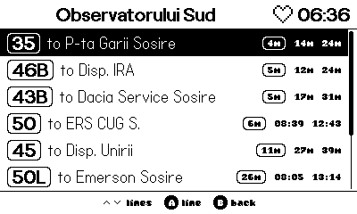
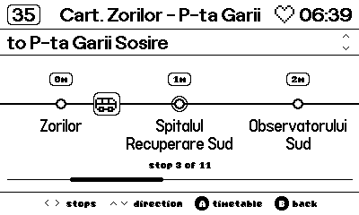
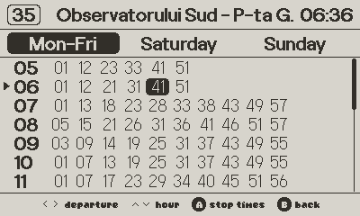
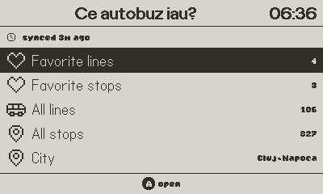
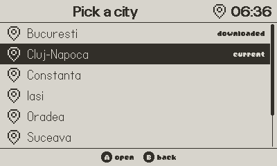

# Ce autobuz iau? for Playdate

The [Ce autobuz iau?](https://github.com/bmarian/conexiuni-cluj) bus, tram and trolleybus timetables on Panic's [Playdate](https://play.date). Pick a city, sync it once over Wi-Fi, and every stop, line and timetable works offline after that.

<table>
<tr>
<td align="center" width="33%">

<br><sub>The next buses at any stop, from all its platforms</sub>
</td>
<td align="center" width="33%">

<br><sub>Each line stop by stop, with the buses that should be on it</sub>
</td>
<td align="center" width="33%">

<br><sub>Full timetables, at any stop along the line</sub>
</td>
</tr>
<tr>
<td align="center" width="33%">

<br><sub>Favorites first</sub>
</td>
<td align="center" width="33%">

<br><sub>Every city the website has</sub>
</td>
<td></td>
</tr>
</table>

## What it does

- Every city the website has, each downloaded once and kept for offline use
- Departures for any stop, from all its platforms in one list
- Each line drawn stop by stop, with the buses that should be on it right now and the minutes to each stop
- Full timetables for weekdays, Saturday and Sunday, at the terminus or at any stop along the line
- One trip's times at every stop
- The times use the travel times the server learned for each hour, and holidays run on the right timetable
- Favorite lines and stops for each city
- Turn the crank to scroll

The cities and where their data comes from are listed in the [website's README](https://github.com/bmarian/conexiuni-cluj#cities).

---

## Running it

You'll need the [Playdate SDK](https://play.date/dev/) with `PLAYDATE_SDK_PATH` set and `%PLAYDATE_SDK_PATH%/bin` on `PATH`.

```bash
git clone https://github.com/bmarian/conexiuni-cluj-playdate
cd conexiuni-cluj-playdate
git submodule update --init
pdc source CeAutobuzIau.pdx
PlaydateSimulator CeAutobuzIau.pdx
```

The app talks to the live API at ceautobuziau.ro, so there's no local backend to run.

<details>
<summary><b>How a city fits in 16 MB</b></summary>

<br>

Each city downloads the same network bundle the website and the phone app use (`/api/{city}/network`). București's is almost 5 MB of JSON, which would take far more than the Playdate's 16 MB once decoded, so it never is: [`lib/bundle.lua`](source/lib/bundle.lua) reads it in chunks, splits it one line at a time and writes an index plus one small file per line and kind of day. The app keeps only the index in memory and reads a line's timetable when a screen needs it, so București peaks at about 4 MB.

Every city has its own folder with its network, favorites and sync time, so switching cities doesn't download anything again. A failed sync keeps the city's previous timetables.

</details>

## Credits

| Source                                                    | Used for                                              |
| --------------------------------------------------------- | ----------------------------------------------------- |
| [Noble Engine](https://github.com/NobleRobot/NobleEngine) | Scenes and transitions                                |
| [pixelarticons](https://pixelarticons.com/)               | Icons                                                 |
| [Panic](https://play.date/dev/)                           | The Roobert and Asheville fonts from the Playdate SDK |
